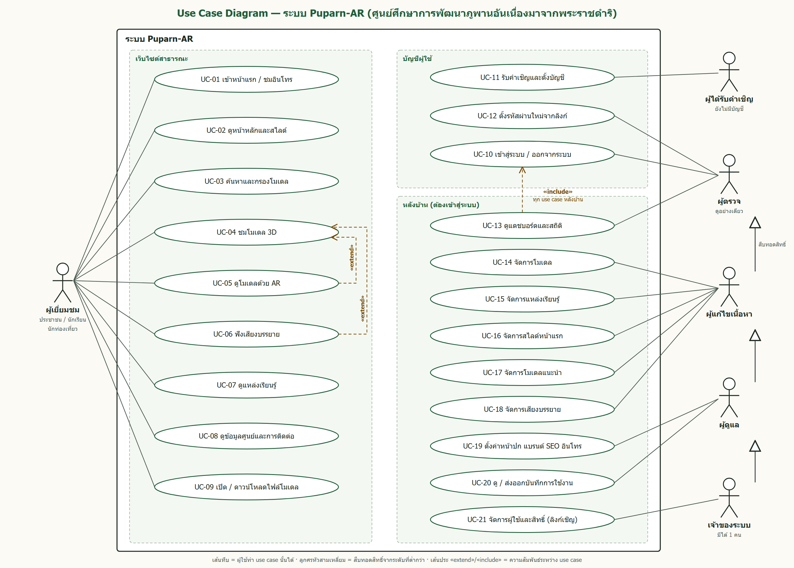

# Use Case ระบบ Puparn-AR (ศูนย์ศึกษาการพัฒนาภูพานอันเนื่องมาจากพระราชดำริ)

ฉบับ 16 ต.ค. 2026 · เขียนตามโค้ดใน branch `review/phuphan-content-admin-login`

ระบบนี้เป็นเว็บไซต์นิทรรศการออนไลน์ แสดงแหล่งเรียนรู้และของดีของศูนย์ภูพานเป็นโมเดล 3 มิติ
ผู้เข้าชมหมุนดูโมเดลได้ วางโมเดลในพื้นที่จริงด้วย AR บนมือถือได้ และฟังเสียงบรรยายได้
ส่วนหลังบ้านมีไว้ให้ทีมงานจัดการเนื้อหา

---

## 1. ผู้ใช้งานระบบ (Actors)

| ผู้ใช้ | คือใคร | ต้องเข้าสู่ระบบไหม |
| --- | --- | --- |
| **ผู้เยี่ยมชม** | ประชาชน นักเรียน นักท่องเที่ยว และผู้สนใจทั่วไป | ไม่ต้อง |
| **ผู้ตรวจ** | ทีมตรวจงาน หรือผู้ที่ต้องการดูหลังบ้านอย่างเดียว | ต้อง |
| **ผู้แก้ไขเนื้อหา** | เจ้าหน้าที่ดูแลข้อมูลโมเดลและแหล่งเรียนรู้ | ต้อง |
| **ผู้ดูแล** | เจ้าหน้าที่ดูแลเว็บไซต์ทั้งหมด | ต้อง |
| **เจ้าของระบบ** | ผู้รับผิดชอบระบบ มีได้ 1 คน | ต้อง |
| **ผู้ได้รับคำเชิญ** | คนที่ได้รับลิงก์เชิญจากเจ้าของ แต่ยังไม่มีบัญชี | ไม่ต้อง (ใช้ลิงก์) |

ระบบภายนอกที่เกี่ยวข้อง:
- **Cloudflare D1** เป็นฐานข้อมูล
- **Cloudflare R2** เก็บไฟล์โมเดล รูป และเสียง
- **Google Gemini** ใช้สร้างเสียงบรรยาย
- **Search engine** เช่น Google ใช้ index หน้าเว็บ

สิทธิ์ของผู้ใช้หลังบ้านซ้อนกันเป็นชั้น: ผู้ตรวจ < ผู้แก้ไขเนื้อหา < ผู้ดูแล < เจ้าของ
ระดับที่สูงกว่าทำได้ทุกอย่างที่ระดับต่ำกว่าทำได้

---

## 2. แผนภาพ Use Case (UML)

ไฟล์ภาพ: [use-case-diagram.png](use-case-diagram.png) (สำหรับส่งหรือพิมพ์) · [use-case-diagram.svg](use-case-diagram.svg) (ขยายได้ไม่แตก)

วิธีอ่านแผนภาพ:
- **กรอบใหญ่** คือขอบเขตระบบ Puparn-AR **คนที่อยู่นอกกรอบ** คือผู้ใช้
- **เส้นทึบ** หมายถึงผู้ใช้คนนั้นทำ use case นั้นได้
- **ลูกศรหัวสามเหลี่ยมโปร่ง** (ด้านขวา) หมายถึงสืบทอดสิทธิ์ ผู้แก้ไขเนื้อหาทำได้ทุกอย่างที่ผู้ตรวจทำได้
  ผู้ดูแลทำได้ทุกอย่างที่ผู้แก้ไขทำได้ และเจ้าของทำได้ทุกอย่าง
- **«extend»** หมายถึงทำต่อยอดจากอีก use case ได้ เช่น ขณะชมโมเดล 3D (UC-04) กดดูด้วย AR (UC-05) หรือกดฟังเสียงบรรยาย (UC-06) ได้
- **«include»** หมายถึงต้องทำ use case นั้นก่อนเสมอ งานหลังบ้านทุกอย่างต้องเข้าสู่ระบบ (UC-10) ก่อน

---

## 3. ตารางสิทธิ์

| Use Case | ผู้เยี่ยมชม | ผู้ตรวจ | ผู้แก้ไขเนื้อหา | ผู้ดูแล | เจ้าของ |
| --- | :-: | :-: | :-: | :-: | :-: |
| UC-01 – UC-09 ส่วนสาธารณะ | ✅ | ✅ | ✅ | ✅ | ✅ |
| UC-10 เข้าสู่ระบบ | – | ✅ | ✅ | ✅ | ✅ |
| UC-13 แดชบอร์ด | – | ดูได้ | ดูได้ | ดูได้ | ดูได้ |
| UC-14 – UC-18 เนื้อหา (โมเดล แหล่งเรียนรู้ สไลด์ แนะนำ เสียง) | – | ดูได้อย่างเดียว | ✅ แก้ได้ | ✅ | ✅ |
| UC-19 ตั้งค่าเว็บ | – | ดูได้อย่างเดียว | ดูได้อย่างเดียว | ✅ แก้ได้ | ✅ |
| UC-20 บันทึกการใช้งาน | – | ❌ | ❌ | ✅ | ✅ |
| UC-21 ผู้ใช้และสิทธิ์ | – | ❌ | ❌ | ❌ | ✅ |

---

## 4. Use Case ฝั่งผู้เยี่ยมชม

### UC-01 เข้าหน้าแรกและชมอินโทร
- **ผู้ใช้:** ผู้เยี่ยมชม
- **ขั้นตอนหลัก:**
  1. เปิดเว็บไซต์ (`/`) ระบบแสดงหน้าปก มีภาพพื้นหลัง ชื่อศูนย์ และปุ่ม "เข้าสู่เว็บไซต์"
  2. กดปุ่ม ระบบแสดงโลโก้อินโทรทีละภาพบนพื้นดำ (ถ้าผู้ดูแลเปิดใช้)
  3. ระบบพาไปหน้าหลัก (`/home`)
- **ทางเลือก:** กด "ข้าม" เพื่อข้ามอินโทรได้ ถ้าปิดอินโทรไว้ ระบบจะไปหน้าหลักทันที

### UC-02 ดูหน้าหลักและสไลด์
- **ผู้ใช้:** ผู้เยี่ยมชม
- **ขั้นตอนหลัก:**
  1. ระบบแสดงข้อความแนะนำ จำนวนแหล่งเรียนรู้และจำนวนโมเดล (นับจากข้อมูลจริง) และสไลด์แหล่งเรียนรู้ที่เลื่อนเอง
  2. ผู้ใช้ปัดหรือกดลูกศรเพื่อเลื่อนสไลด์
  3. แตะสไลด์ ระบบเปิดหน้าต่าง popup แสดงรายละเอียด ปิดได้ด้วยปุ่มปิดหรือปุ่ม Esc
- **ทางเลือก:** บนคอมพิวเตอร์ เอาเมาส์ชี้สไลด์จะเห็นแผงรายละเอียดลอยขึ้นมา (hover)

### UC-03 ค้นหาและกรองโมเดล
- **ผู้ใช้:** ผู้เยี่ยมชม
- **ขั้นตอนหลัก:**
  1. เปิดหน้า "โมเดล 3D" (`/models`)
  2. พิมพ์คำค้นหาจากชื่อหรือคำอธิบาย และ/หรือเลือกแหล่งเรียนรู้
  3. ระบบแสดงเฉพาะโมเดลที่ตรงเงื่อนไขทันที
- **ทางเลือก:** ถ้าไม่พบ ระบบบอก "ไม่พบโมเดลที่ตรงกับการค้นหา" และแนะนำให้ล้างคำค้น

### UC-04 ชมโมเดล 3D
- **ผู้ใช้:** ผู้เยี่ยมชม
- **ก่อนเริ่ม:** โมเดลนั้นตั้งค่า "แสดง" ไว้
- **ขั้นตอนหลัก:**
  1. เลือกโมเดล ระบบเปิดหน้ารายละเอียด (`/models/<id>`)
  2. ระบบโหลดโมเดลจาก R2 แล้วแสดงในกรอบ 3D
  3. ผู้ใช้ลากเพื่อหมุน และบีบหรือเลื่อนเพื่อซูม
  4. ดูคำอธิบาย แกลเลอรีรูป และโมเดลที่เกี่ยวข้อง
- **ทางเลือก:** ถ้าโหลดโมเดลไม่ได้ ระบบแสดงข้อความแจ้ง พร้อมปุ่มกลับไปรายการโมเดล เปิดไฟล์โดยตรง หรือกลับไปแหล่งเรียนรู้

### UC-05 ดูโมเดลในพื้นที่จริงด้วย AR
- **ผู้ใช้:** ผู้เยี่ยมชมที่ใช้มือถือรองรับ AR (Android ที่มี ARCore หรือ iPhone/iPad)
- **ขั้นตอนหลัก:**
  1. ในหน้าโมเดล กด "เปิด AR" แล้วอนุญาตให้ใช้กล้อง
  2. หันกล้องไปที่พื้นราบ ระบบตรวจจับพื้น แล้วแตะเพื่อวางโมเดล
  3. ลากหรือบีบเพื่อย้าย หมุน หรือปรับขนาด แล้วปิดเพื่อกลับเว็บ
- **ทางเลือก:**
  - ถ้าเครื่องไม่รองรับ จะไม่มีปุ่ม AR แต่ยังหมุนดูแบบ 3D ได้
  - ถ้าเปิดจาก LINE หรือ Facebook หน้าเว็บแนะนำให้เปิดในเบราว์เซอร์ก่อน

### UC-06 ฟังเสียงบรรยาย
- **ผู้ใช้:** ผู้เยี่ยมชม
- **ขั้นตอนหลัก:** กด "ฟังเสียงบรรยาย" ระบบเล่นไฟล์เสียงของโมเดล กดอีกครั้งเพื่อหยุด
- **ทางเลือก:** ถ้าโมเดลไม่มีเสียง ระบบแสดง "ไม่มีเสียงบรรยาย" (บนการ์ดโมเดลก็มีป้ายบอกว่าโมเดลไหนมีเสียง)

### UC-07 ดูแหล่งเรียนรู้
- **ผู้ใช้:** ผู้เยี่ยมชม
- **ขั้นตอนหลัก:** เลือกแหล่งเรียนรู้ เช่น งานหม่อนไหม ระบบแสดงคำอธิบายและโมเดลทั้งหมดในแหล่งนั้น (`/projects/<id>`)

### UC-08 ดูข้อมูลศูนย์และการติดต่อ
- **ผู้ใช้:** ผู้เยี่ยมชม
- **ขั้นตอนหลัก:** ดูบทบาทและภารกิจของศูนย์ ที่ตั้ง เบอร์โทร (กดโทรได้บนมือถือ) และลิงก์แผนที่ พร้อมแหล่งอ้างอิงข้อมูล

### UC-09 เปิดหรือดาวน์โหลดไฟล์โมเดล
- **ผู้ใช้:** ผู้เยี่ยมชม
- **ขั้นตอนหลัก:**
  1. กด "เปิดไฟล์โมเดลโดยตรง" ระบบเปิดหรือดาวน์โหลดไฟล์ `.glb`
  2. หน้าเว็บอธิบายวิธีเปิดไฟล์ด้วย Blender (File → Import → glTF 2.0)

---

## 5. Use Case ด้านบัญชีผู้ใช้

### UC-10 เข้าสู่ระบบและออกจากระบบ
- **ผู้ใช้:** ผู้ตรวจ ผู้แก้ไขเนื้อหา ผู้ดูแล เจ้าของ
- **ขั้นตอนหลัก:**
  1. เปิด `/admin/login` แล้วกรอกชื่อผู้ใช้และรหัสผ่าน
  2. ระบบตรวจกับข้อมูลใน D1 ซึ่งเก็บรหัสเป็น hash เท่านั้น
  3. ผ่านแล้วเข้าหลังบ้าน เมนูจะแสดงชื่อและระดับสิทธิ์ของผู้ใช้
  4. กด "ออกจากระบบ" เพื่อจบการใช้งาน
- **ทางเลือก:**
  - ชื่อหรือรหัสผิด ระบบแจ้ง "ชื่อผู้ใช้หรือรหัสผ่านไม่ถูกต้อง" โดยไม่บอกว่าผิดช่องไหน
  - ผิดติดกัน 5 ครั้งภายใน 15 นาที ระบบพักการเข้าสู่ระบบจาก IP นั้นชั่วคราว
  - บัญชีถูกระงับ เข้าสู่ระบบไม่ได้ และ session ที่เปิดค้างอยู่ก็หลุดทันที
- **กฎ:** ไม่มีหน้าสมัครสมาชิก และหน้าเว็บจริงไม่เปิดให้ตั้งบัญชีครั้งแรก

### UC-11 รับคำเชิญและตั้งบัญชี
- **ผู้ใช้:** ผู้ได้รับคำเชิญ
- **ก่อนเริ่ม:** เจ้าของส่งลิงก์เชิญให้ (ดู UC-21)
- **ขั้นตอนหลัก:**
  1. เปิดลิงก์ ระบบแสดงว่าได้รับสิทธิ์ระดับใด
  2. ตั้งชื่อผู้ใช้ ชื่อที่แสดง และรหัสผ่าน อย่างน้อย 12 ตัว พิมพ์ซ้ำเพื่อยืนยัน
  3. ระบบสร้างบัญชีตามสิทธิ์ที่เชิญ และพาเข้าหลังบ้านทันที
- **ทางเลือก:**
  - ลิงก์ถูกใช้แล้ว หมดอายุ (เกิน 48 ชม.) หรือถูกยกเลิก ระบบแจ้งให้ขอลิงก์ใหม่
  - ชื่อผู้ใช้ซ้ำหรือรหัสสั้นไป ระบบแจ้งข้อผิดพลาด และลิงก์ยังใช้ต่อได้

### UC-12 ตั้งรหัสผ่านใหม่จากลิงก์
- **ผู้ใช้:** ผู้ใช้หลังบ้านที่ลืมรหัส (ยกเว้นเจ้าของ)
- **ขั้นตอนหลัก:**
  1. ขอให้เจ้าของสร้างลิงก์ตั้งรหัสใหม่ แล้วเปิดลิงก์
  2. ตั้งรหัสใหม่ ระบบตัด session เก่าทุกเครื่อง แล้วให้เข้าสู่ระบบใหม่
- **กฎ:** ลิงก์ใช้ได้ครั้งเดียวและหมดอายุใน 48 ชม. ถ้าเจ้าของลืมรหัส ต้องให้ผู้ดูแลระบบเปลี่ยนผ่านสคริปต์

---

## 6. Use Case ฝั่งหลังบ้าน

### UC-13 ดูแดชบอร์ดและสถิติผู้เข้าชม
- **ผู้ใช้:** ทุกระดับในหลังบ้าน
- **ขั้นตอนหลัก:**
  1. เปิดแดชบอร์ด ระบบแสดงจำนวนผู้เข้าชมและการเปิดหน้า (วันนี้, 7 วัน, 30 วัน)
  2. ดูแนวโน้ม 24 ชม., 7 วัน, 30 วัน หรือ 12 เดือน
  3. ดูประเทศ แหล่งที่มา และหน้าที่มีผู้ชมสูงสุด
  4. ดูความสมบูรณ์ของข้อมูลและสถานะไฟล์สื่อ
- **ทางเลือก:** เลือกวันที่ในปฏิทินเพื่อดูสถิติย้อนหลัง

### UC-14 จัดการโมเดล
- **ผู้ใช้:** ผู้แก้ไขเนื้อหาขึ้นไป (ผู้ตรวจดูได้อย่างเดียว)
- **ขั้นตอนหลัก:**
  1. เพิ่มโมเดล: กรอกชื่อ คำอธิบาย และหน่วยงาน เลือกแหล่งเรียนรู้ อัปโหลดไฟล์ `.glb` (≤ 50 MB) และรูปปก
     ปรับขนาดและมุมหมุน แล้วเลือกแสดงหรือซ่อน
  2. ระบบอัปโหลดไฟล์ขึ้น R2 แล้วบันทึกข้อมูลลง D1
  3. แก้ไขหรือลบโมเดล หรือสลับการแสดงผลได้
- **ทางเลือก:** ถ้ามีคนอื่นแก้ข้อมูลเดียวกันก่อน ระบบไม่บันทึกทับ และแจ้งให้โหลดหน้าใหม่

### UC-15 จัดการแหล่งเรียนรู้
- **ผู้ใช้:** ผู้แก้ไขเนื้อหาขึ้นไป
- **ขั้นตอนหลัก:** เพิ่มแหล่งเรียนรู้ (ชื่อ คำอธิบาย รูปปก) แก้ไข ซ่อน หรือลบ
- **กฎ:** การลบแหล่งเรียนรู้จะลบโมเดลในแหล่งนั้นด้วย โดยทำในครั้งเดียว (สำเร็จทั้งหมดหรือไม่เปลี่ยนเลย)

### UC-16 จัดการสไลด์หน้าแรก
- **ผู้ใช้:** ผู้แก้ไขเนื้อหาขึ้นไป
- **ขั้นตอนหลัก:** เพิ่มสไลด์ (หัวข้อ คำอธิบาย รูป ข้อความปุ่ม ลิงก์ ลำดับ) แก้ไข ปิดใช้งาน หรือลบ

### UC-17 จัดการโมเดลแนะนำ
- **ผู้ใช้:** ผู้แก้ไขเนื้อหาขึ้นไป
- **ขั้นตอนหลัก:** เลือกโมเดลที่จะแนะนำบนหน้าแรกได้สูงสุด 10 รายการ ใส่เลขลำดับ (เลขน้อยแสดงก่อน) แล้วบันทึก

### UC-18 จัดการเสียงบรรยาย
- **ผู้ใช้:** ผู้แก้ไขเนื้อหาขึ้นไป
- **ขั้นตอนหลัก:**
  1. เปิดหน้าเสียงบรรยาย ค้นหาหรือกรองโมเดลตามแหล่งเรียนรู้ สถานะเสียง หรือการแสดงผล
  2. กด "สร้างเสียงใหม่" ระบบใช้ Gemini สร้างเสียงจากคำอธิบาย แล้วเก็บไว้เป็นร่าง ยังไม่เผยแพร่
  3. ฟังร่าง ถ้าพอใจกด "ยืนยันใช้เสียงนี้" ถ้าไม่พอใจกด "ยกเลิก"
- **ทางเลือก:** ถ้ามีคนเปลี่ยนเสียงของโมเดลนั้นไปก่อน ระบบไม่ให้ยืนยัน และแจ้งให้สร้างใหม่
- **กฎ:** เสียงเดิมยังเก็บไว้ใน R2 ไม่ถูกลบ เพื่อให้ย้อนกลับได้

### UC-19 ตั้งค่าหน้าปก แบรนด์ SEO และอินโทร
- **ผู้ใช้:** ผู้ดูแลขึ้นไป (ผู้แก้ไขเนื้อหาและผู้ตรวจดูได้อย่างเดียว)
- **ขั้นตอนหลัก:**
  - แก้ข้อความและภาพหน้าปก ขนาดตัวอักษร และดูตัวอย่างก่อนบันทึก
  - แก้ชื่อเว็บ โลโก้ favicon และคำอธิบายสำหรับ SEO หรือการแชร์
  - ตั้งค่าโลโก้อินโทร (เปิด/ปิด ระยะเวลา รูปแบบการแสดง)

### UC-20 ดูและส่งออกบันทึกการใช้งาน (Audit Log)
- **ผู้ใช้:** ผู้ดูแลขึ้นไป
- **ขั้นตอนหลัก:**
  1. ดูรายการเหตุการณ์ล่าสุด เช่น เข้าสู่ระบบ แก้ไขข้อมูล หรือจัดการผู้ใช้ แต่ละรายการบอกว่าใครทำ สิทธิ์ใด เมื่อไร จาก IP ใด
  2. กรองตามหมวด ผลลัพธ์ หรือคำค้น
  3. ส่งออกเป็น CSV หรือ JSON
- **กฎ:** ทุกบันทึกมีลายเซ็นดิจิทัล หน้าเว็บบอกได้ว่าบันทึกถูกแก้ไขหรือไม่

### UC-21 จัดการผู้ใช้และสิทธิ์
- **ผู้ใช้:** เจ้าของระบบเท่านั้น
- **ขั้นตอนหลัก (เชิญผู้ร่วมงาน):**
  1. เปิด "ผู้ใช้และสิทธิ์" เลือกสิทธิ์ (ผู้ดูแล / ผู้แก้ไขเนื้อหา / ผู้ตรวจ) และใส่หมายเหตุ
  2. กด "สร้างลิงก์เชิญ" ระบบแสดงลิงก์**เพียงครั้งเดียว**
  3. คัดลอกลิงก์ส่งให้ผู้รับทางช่องทางส่วนตัว แล้วผู้รับทำต่อตาม UC-11
- **การจัดการอื่น:**
  - เปลี่ยนสิทธิ์ มีผลทันทีแม้ผู้ใช้กำลังเปิดหน้าเว็บอยู่
  - ระงับหรือเปิดใช้บัญชี ถ้าระงับ ผู้ใช้หลุดจากระบบทันที
  - สร้างลิงก์ตั้งรหัสใหม่ให้ผู้ใช้ที่ลืมรหัส (UC-12)
  - ยกเลิกลิงก์ที่ยังไม่ถูกใช้
- **กฎ:**
  - มีเจ้าของได้ 1 คน และเชิญใครเป็นเจ้าของไม่ได้
  - แก้หรือระงับบัญชีเจ้าของผ่านหน้าเว็บไม่ได้
  - ระบบเก็บเฉพาะรหัสแฮชของลิงก์ ไม่เก็บตัวลิงก์

---

## 7. กฎที่ระบบทำให้อัตโนมัติ (ผู้ใช้ไม่ต้องทำเอง)

| กฎ | ผลต่อผู้ใช้ |
| --- | --- |
| นับสถิติผู้เข้าชม (เว็บจริงเท่านั้น) | แสดงในแดชบอร์ด UC-13 โดยไม่เก็บข้อมูลระบุตัวตนโดยตรง |
| ป้องกันการบันทึกทับกัน | ถ้าสองคนแก้ข้อมูลชุดเดียวกัน คนที่บันทึกทีหลังต้องโหลดหน้าใหม่ก่อน ข้อมูลของอีกคนไม่หาย |
| ป้องกันการส่งฟอร์มปลอม (CSRF) | ฟอร์มหลังบ้านและหน้าเข้าสู่ระบบส่งได้จากหน้าเว็บนี้เท่านั้น |
| ฐานข้อมูลขัดข้อง | ระบบแจ้ง "ระบบฐานข้อมูลไม่พร้อมใช้งาน" แทนการแสดงข้อมูลเก่าหรือผิด |
| เว็บทดสอบ (phuphan-ar-review) | ไม่ให้ Google เก็บหน้าเว็บ และไม่นับสถิติ |

---

## 8. ข้อจำกัดปัจจุบัน (16 ต.ค. 2026)

- อัปโหลดไฟล์ใน UC-14 – UC-16 และสร้างเสียงใน UC-18 ต้องตั้งค่า R2 upload key และ Gemini key ก่อน ตอนนี้เว็บทดสอบยังไม่มี
- UC-04 และ UC-05 บนเว็บทดสอบต้องเพิ่มโดเมนนี้ใน R2 CORS ก่อน
- ยังไม่ได้ทดสอบ AR (UC-05) บนมือถือจริง
